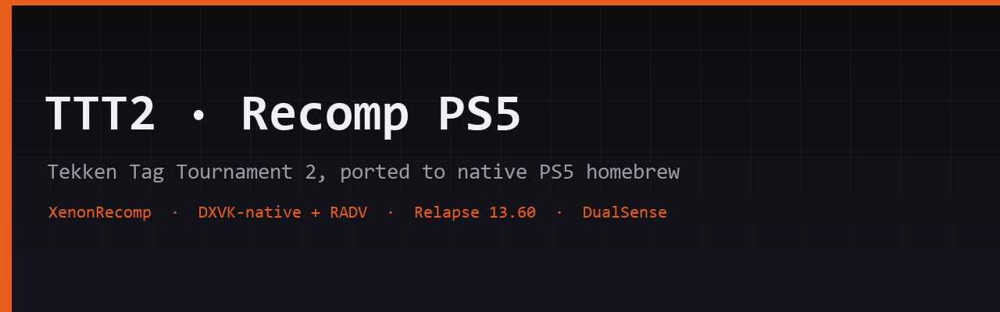

  

<h1 align="center">TTT2 · Recomp PS5</h1>

  <b>Native PlayStation 5 homebrew port of Tekken Tag Tournament 2 (Xbox 360), via static recompilation.</b>

  
  
  
  
  

> **English** below · **Español** al final

---

## What is this

This is a fork of [`shihabal3amri/tekken-tag-tournament-2-pc`](https://github.com/shihabal3amri/tekken-tag-tournament-2-pc) — the native Windows port of the Xbox 360 build of Tekken Tag Tournament 2, created by static recompilation (XenonRecomp). That port compiles the game's original PowerPC code into ordinary x86-64 C++ and reimplements the game's graphics API on DirectX 11.

**This fork's goal:** run that same game natively as homebrew on a jailbroken PlayStation 5 (standard console, firmware 13.60). The PS5's CPU is x86-64, so the recompiled game code does not need to change — the work lives in the platform layers: instead of Windows APIs, the port runs on `sceVideoOut`, `scePad`, `sceAudioOut` and friends, with the existing D3D11 renderer running over Vulkan through DXVK-native and the PS5 Mesa RADV driver, following the route demonstrated by [UnleashedRecomp-Prospero](https://github.com/Nazky/UnleashedRecomp-Prospero).

No game assets are included or redistributed. You must own the game: the PC port builds all game data from your own Xbox 360 disc image and Title Update 3. The PS5 build consumes those same generated files.

## How it runs on the PS5

| Layer | On the PS5 | Notes |
|---|---|---|
| Game code | recompiled C++ (x86-64) | unchanged from upstream |
| Game renderer | D3D11, as upstream | unchanged |
| D3D11 → Vulkan | DXVK-native, statically linked | upstream already ships the patches (SDL3 / shared WSI, Android-ready) |
| Vulkan driver | Mesa RADV for Prospero (`radv-winsys=ps5`) | scene fork, as used by UnleashedRecomp-Prospero |
| Presentation | `VK_KHR_display` surface → `sceVideoOut` | custom WSI; SDL-as-shell is deliberately not used |
| Input | `scePad` (DualSense), mapped onto the game's XInput layer | haptics optional |
| Audio | `sceAudioOut` | small new module |
| Storage | content and saves under `/data/homebrew/<title>/` | upload via the payload manager (FTP) |
| Launch | Relapse ELF loader on port 9021 (ps5-payload-dev ecosystem) | firmware 7.00–13.60 supported |

## Roadmap

| Milestone | Goal | Status |
|---|---|---|
| **M0** | Boot spike: build inventory + platform-surface report | ✅ done ([report](docs/superpowers/m0-platform-surface.md)) |
| **M1** | Baseline: game builds and runs on Windows from the user's own copy | ✅ done — the game boots to menu and combat at 60 fps with the hardware D3D11 renderer as the default pipeline |
| **M2** | Multiplatform build proof (WSL2, software rasterizer — portability only) | ✅ done — full Linux build live (DXVK-native + LAVAPIPE); findings F1–F4 closed |
| **M3** | Prospero toolchain + minimal ELF boots on the console | ✅ done — validated on a real PS5: 3/3 payloads via the Relapse elfldr (port 9021), resident FTP server |
| **M4** | DXVK-native + RADV on PS5: first frame on screen | 🔄 in progress — see notes below |
| **M5** | Fully playable offline: saves, DualSense, audio, 60 fps | ⬜ not started |
| **M6** | Online (optional): direct IP + community server; Steamworks removed | ⬜ not started |

### M4 progress log (updated 2026-10-28)

- **RADV-PS5 built and GO:** the Mesa RADV fork for the console (`radv-winsys=ps5`, static 272 MB archive) reports **Vulkan 1.4** and every DXVK-critical feature/extension verified (timeline semaphores, robustness2, transform feedback, BC1-7…). Evidence: [`m4-radv-ps5-vulkaninfo.txt`](.superpowers/m4-radv-ps5-vulkaninfo.txt).
- **Boot splash working:** the port shows its own credits screen ("TEKKEN TAG TOURNAMENT 2 · RECOMPILADO") before the game's logo sequence, on both present paths, with a hand-made 8x8 font — caught and fixed a glyph-mirroring bug (LSB-first font, off-by-one index) while porting it.
- **DXVK-native statically linked for the PS5 (new):** a `display` WSI backend (VK_KHR_display → sceVideoOut, no window manager) lands as a repo patch; cross-built with the console SDK into 8 static archives (`d3d11_static`, `dxgi_static`, core, dxbc…). `nm` verifies the D3D11/DXGI entry points the game links against.
- **The console ELF links (new):** port + DXVK statics + RADV + FFmpeg XMA + vkd3d-shader + OpenSSL now produce a single 216 MB `llvm-pie.elf` with `_start` at `0x5174140`, zero undefined symbols, and only the modules it actually imports as `NEEDED` (Agc, AudioOut, LibcInternal, Pad, UserService, VideoOut, kernel). `D3D11CreateDevice`, `D3D11CreateDeviceAndSwapChain`, `CreateDXGIFactory1` and `D3DCompile` are defined inside it.
- **Next (Task 6):** upload and launch on the console for the first frame on the TV.

Design document: [`docs/superpowers/specs/2026-10-26-ttt2-ps5-port-design.md`](docs/superpowers/specs/2026-10-26-ttt2-ps5-port-design.md) · Implementation plans: [M0+M1](docs/superpowers/plans/2026-10-26-m0-m1-windows-build.md) · [M3](docs/superpowers/plans/2026-10-27-m3-prospero-console-boot.md) · [M4](docs/superpowers/plans/2026-10-27-m4-radv-first-frame.md)

## Building today

Today the fork builds exactly like upstream — see upstream's [`BUILDING.md`](BUILDING.md). The PS5 toolchain is landing now: the M4 scripts (DXVK cross build + RADV for the console) live in [`tools/ps5/dxvk/`](tools/ps5/dxvk/), consumed from WSL against the pinned mihawk-99 payload SDK. Full PS5 build instructions will be documented here when M4 closes.

## License and legal

- Unofficial fan project, not affiliated with or endorsed by Bandai Namco or Microsoft.
- Ships **no game data**: no art, sound, stages, movies or code from the disc. Everything is generated on your machine from **your own legally acquired copy**.
- Upstream's third-party components apply unchanged: XenonRecomp (MIT), FFmpeg (LGPL), libmspack (LGPL), tiny-AES-c, Steamworks SDK (© Valve, optional in this fork).
- XSX/X360 disc images, XEX binaries and title updates must never be committed or redistributed from this repository.
- For security-research context, the PS5 side relies on publicly documented scene tooling; use it only on consoles you own.

## Credits

- [`shihabal3amri`](https://github.com/shihabal3amri/tekken-tag-tournament-2-pc) — the Windows port this fork extends.
- [`hedge-dev/XenonRecomp`](https://github.com/hedge-dev/XenonRecomp) and the [`UnleashedRecomp`](https://github.com/hedge-dev/UnleashedRecomp) team — the recompilation methodology and the graphics abstraction that inspired the PS5 strategy.
- [`Nazky/UnleashedRecomp-Prospero`](https://github.com/Nazky/UnleashedRecomp-Prospero) — the first full Xbox-360-recomp → PS5 route (RADV on Prospero, toolchain, packaging); this fork follows its blueprint.
- The PS5 scene tooling this port depends on: [Relapse exploit](https://github.com/ntfargo/Relapse-Exploit) (Sonic_Iso, Jordy, ntfargo, ufm42) and the ps5-payload-dev ecosystem by [TheFlow](https://github.com/TheOfficialFloW) and the scene at large.

---

## Español

**Qué es:** fork del port nativo de Windows de Tekken Tag Tournament 2 (Xbox 360, recompilación estática) con un objetivo: que el juego funcione **nativamente como homebrew en una PS5 estándar con firmware 13.60** (exploit Relapse). El CPU de la PS5 es x86-64, así que el código recompilado no cambia: el trabajo está en las capas de plataforma (gráficos vía DXVK-native + RADV de Mesa, entrada con `scePad`, audio con `sceAudioOut`, contenido en `/data/homebrew`, arranque por el cargador de ELF de Relapse).

**Estado (2026-10-28):** M0-M3 cerrados - el juego corre en Windows a 60 fps (build base), compila también en Linux (DXVK-native), y el toolchain del Prospero ya corre en una PS5 real (payloads por elfldr 9021 + FTP residente). M4: RADV-PS5 construido con veredicto GO (Vulkan 1.4 y todas las extensiones que DXVK exige), splash de créditos funcionando, DXVK-native cross-compilado como estáticos con un backend WSI `display` nuevo (VK_KHR_display → sceVideoOut) y **el ELF completo ya enlaza** (216 MB, `_start` real, cero símbolos sin resolver). Queda subirlo y lanzarlo en la consola: el primer frame en la TV.

**Aviso:** proyecto no oficial, sin assets del juego incluidos: necesitas tu propia copia del juego de Xbox 360 para generar los datos. Úsalo solo en consolas que te pertenezcan.
